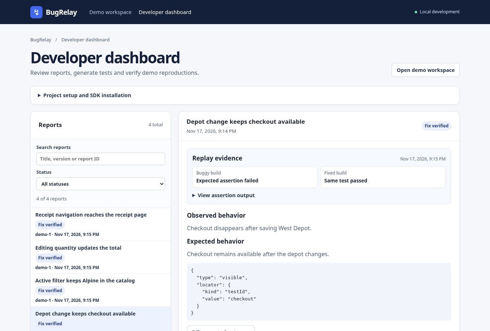
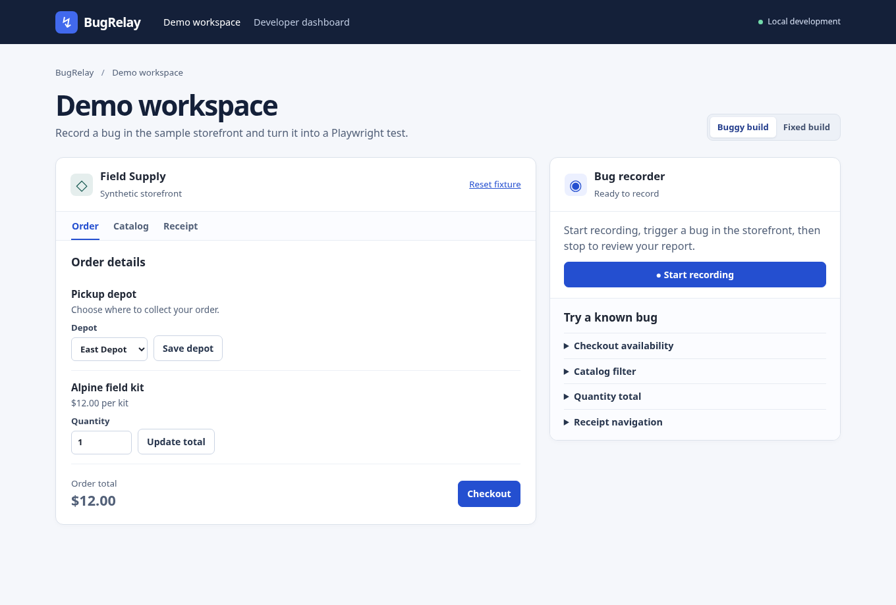

# BugRelay

**Turn a browser bug report into a Playwright regression test.**

[](https://github.com/sairamande5-svg/bugrelay/actions/workflows/check.yml)
[](LICENSE)

[Run locally](#run-locally) · [Try the demo](#try-the-demo) · [Benchmark results](docs/BENCHMARKS.md) · [Architecture](docs/ARCHITECTURE.md)

A tester records a broken browser flow and writes down what should happen. BugRelay turns those steps and that expectation into an editable Playwright test. The developer dashboard shows whether the **same test** fails at the intended assertion on a buggy build and passes on a fixed build.



| Record | Triage | Verify |
| --- | --- | --- |
| Capture clicks, opted-in field changes, dropdown choices, and in-app navigation. Review the recording before submitting. | Search by title, app version, or report ID. Filter by status. Correct an expected outcome without recording again. | Download the generated test and JSON report. Replay the approved sample against both builds and inspect assertion output. |

## Run locally

### Node.js quickstart

Install [Node.js 24 LTS](https://nodejs.org/en/download) and Git. Open a new terminal after installation.

**Windows PowerShell**

```powershell
git clone https://github.com/sairamande5-svg/bugrelay.git
cd bugrelay
npm.cmd ci
npm.cmd run demo
```

**macOS or Linux**

```sh
git clone https://github.com/sairamande5-svg/bugrelay.git
cd bugrelay
npm ci
npm run demo
```

The demo command installs Playwright Chromium, builds the app and starts the local server. When the terminal prints **BugRelay local development**, keep it running and open [127.0.0.1:4173](http://127.0.0.1:4173) in your browser. If the browser reports a refused connection, check the startup terminal for the error. On Linux, install missing browser system dependencies with `npx playwright install --with-deps chromium`. After the first run, `npm run dev` starts the app using the installed browser.

### Docker Compose

From the cloned repository, start Docker first, then run `docker compose up --build`. Compose binds the app port to loopback and keeps reports in a named volume. The local demo dashboard defaults to the credential `local-dashboard`.

## Try the demo

1. On the **Buggy build**, click **Start recording**. Select **West Depot**, then click **Save depot**. Checkout disappears.
2. Stop recording. Expand **Checkout availability**, choose **Use example expectation**, then submit the report.
3. In the dashboard, click **Generate test**, then **Replay approved demo test**. Expand **View assertion output** to inspect the failure.
4. Download the test, or edit the expectation and generate again. Changing the generated test clears its previous replay evidence.

Use **Reset fixture** to try the Catalog, Quantity total, and Receipt examples.

<details>
<summary>View the recording workspace</summary>



</details>

## What the benchmark verifies

The local benchmark recorded and downloaded four fixture tests through the UI, then replayed each test three times on each build.

| Check | Result |
| --- | --- |
| Intended assertion failed on the buggy build | 12/12 |
| The same test passed on the fixed build | 12/12 |
| Fixtures with inconsistent outcomes | 0/4 |
| Minified standalone SDK | 4.2 KB raw, 2.0 KB gzip |

A fifth diagnostic report was flagged for review because its recording contained an ambiguous locator and an unsupported step. These measurements cover synthetic fixtures in Chromium. [See the methodology and raw denominators](docs/BENCHMARKS.md).

## Install the SDK

Build with `npm run build` and copy `dist/sdk.js` into your React app or download the bundle from the dashboard. TypeScript consumers can also vendor the source in `packages/sdk` and the shared `packages/report-schema/privacy.ts` and type declarations. No package registry account is needed.

```ts
import { createBugRelay } from './sdk.js';

const relay = createBugRelay({
  endpoint: location.origin,
  project: 'demo',
  ingestionKey: 'local-ingestion',
  appVersion: '1.2.0',
});

relay.start(); // Start button handler
const reviewed = relay.stop(); // Stop button handler. Render events and logs for review.
// Submit button handler, after the tester has reviewed and removed entries:
if (reviewed) {
  await relay.submit({
    title: 'Save hides the confirmation',
    observed: 'The confirmation is missing after Save.',
    expected: 'The confirmation is visible after Save.',
    assertion: { type: 'visible', locator: { kind: 'testId', value: 'confirmation' } },
  }, reviewed);
}
```

Configure your React dev server to proxy `/api/projects` to `http://127.0.0.1:4173`. Add `data-bugrelay-allow` to specific text inputs and single-select dropdowns approved for recording. Use unique, stable test IDs or accessible names and labels. Mark recorder controls with `data-bugrelay-ignore`. The included React recorder implements controls, preview, removals and an assertion builder.

The API recognizes one configured project per local instance. Set `BUGRELAY_PROJECT`, `BUGRELAY_READ_KEY`, and `BUGRELAY_INGESTION_KEY` to change the defaults. The ingestion key is intentionally browser-visible. The dashboard credential authorizes read, editing, export, verification and deletion and belongs only in developer hands.

## Verify and contribute

With Chromium installed, run:

```sh
npm run check
npm run benchmark
```

GitHub Actions runs the checks and browser workflow on Linux and Windows. The app uses React, TypeScript, Express, SQLite, and Playwright. Hosted multi-user access and arbitrary hosted replay are outside the scope of the local demo. Exported tests for other applications run in the developer's own Playwright project.

[Architecture and privacy](docs/ARCHITECTURE.md) · [Contributor guide](CONTRIBUTING.md) · [Milestones](docs/PROGRESS.md) · [Dependency notices](THIRD_PARTY_NOTICES.md)
